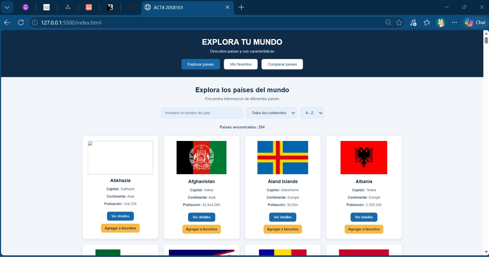
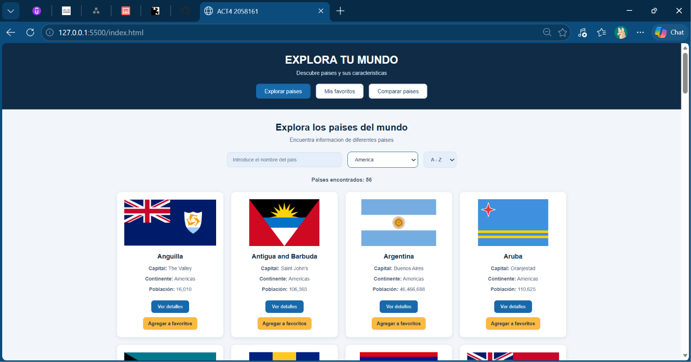
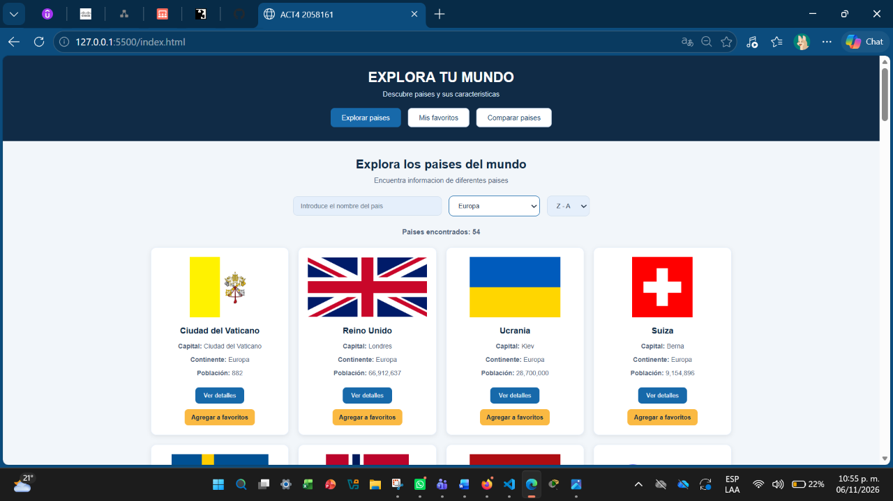
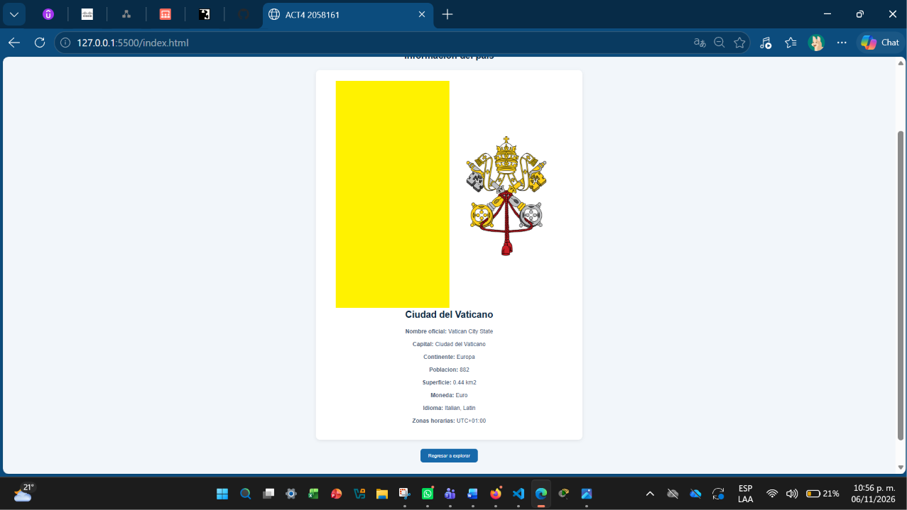
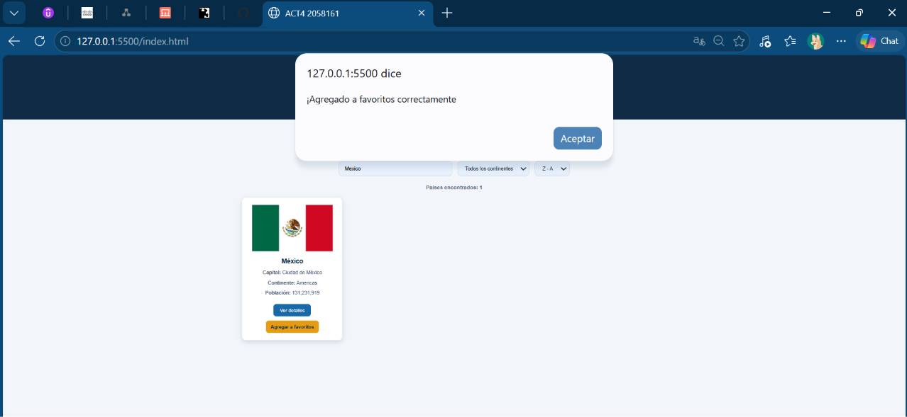
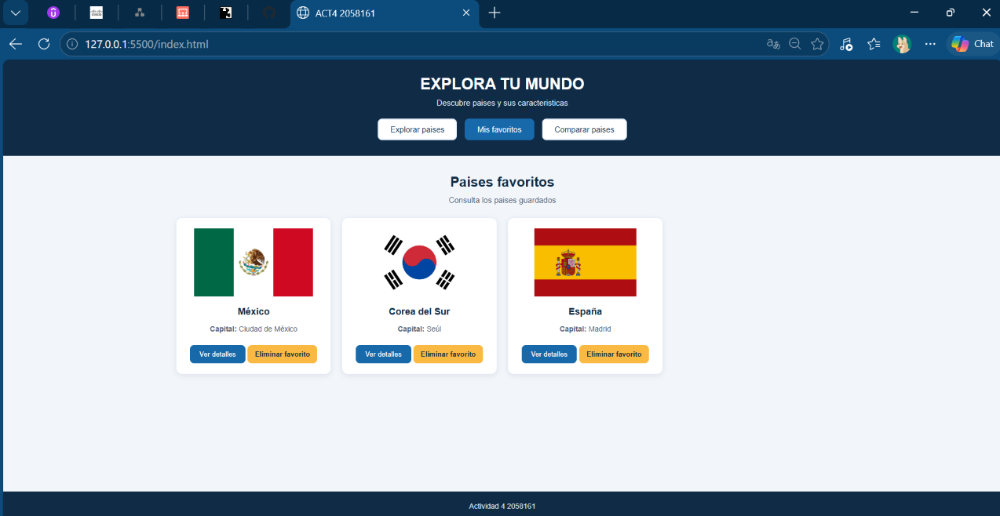
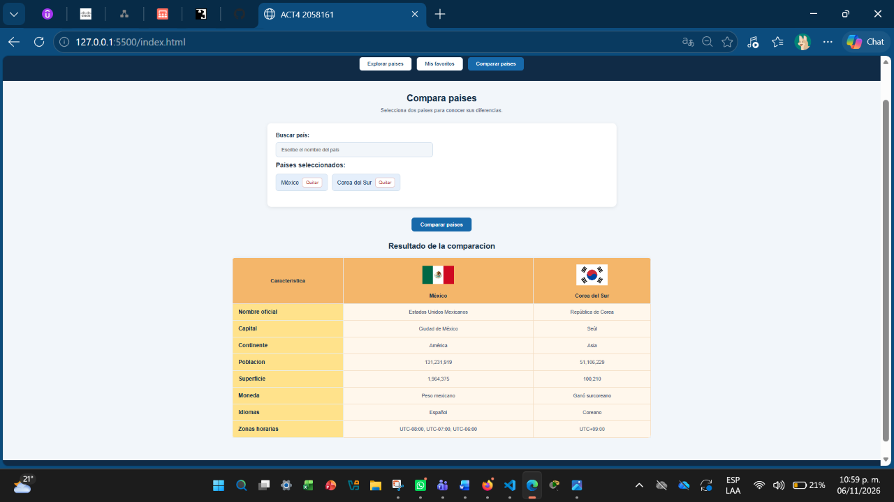

# ACT4-MINIAPPWEB-2058161-LABPROWEB
Actividad 4 Miniaplicación Web consumiendo una API RESET 2058161

# Explora tu mundo 
Aplicación web interactiva explora información de diferentes países del mundo utilizando una API RESET, se consultan datos, busqueda de paises, filtardos, favoritos y comparacion de 2 o más países.

## Objetivo
Integrar una aplicación web con un servicio externo mediante una API RESET, utilizando JSON, fetch API y programación asíncrona pra obtener , procesar y presentar información.

## Funcionalidades
* Explora y visualiza países disponibles, banderas y caracteristicas.
* Busqueda de países mediante nombre.
* Filtro de países por continente.
* Orden  alfabetico para organizar los resultados de los países.
* Ver detalle del país, consulta su información, como capital, población, superficie, moneda, idiomas y zona horaria.
* Agregar a favoritos el país que se desee, e igual permite eliminarlo de favoritos, la información se guarda mediante LocalStorage.
* Comparación de caracteristicas de  2 o más países en tabla.
* Manejo de estados: muestra mensaje de carga, resultados vacíos.

## Tecnologías utilizadas
* HTML5
* CSS3
* JavaScript
* Fetch API
* Async/Await
* LocalStorage
* REST Countries API

## API utilizada --> REST COUNTRIES API
Proporciona información estructurada de países, como nombre, códigos, capitales, banderas, moneda, idiomas y datos geográficos.
La información obtenida se utiliza para mostar dinamicamente los países dentro de la aplicación y permitir que el usuario explore sus caracteristicas, consulte detalles, guarde favoritos y compare diferentes paises

### Documentación: 
https://restcountries.com/docs
### API utilizada:
Countries API v5
### Método HTTP: 
GET
### Endpoint: 
Realiza solicitudes HTTP mediante GET al endpoint de RESET Countries API
### Parámetros utilizados
* Limit, para indicar la cantidad de registros solciitados.
* offset, para indicar desde que registro comienza la consulta.

## Formatos de respuesta
Devuelve datos en formato JSON, la información principal esta em data.objects y los metadatos de paginación en data.meta

## Campos utilizados por la app
* name.common = nombre común del país
* names.offcial = nombre oficial
* flag.url_png = imagen de la bandera
* capitals = capital del país
* region = región
* population = población
* area.kilometers = superficie en kilometros cuadrados
* currencies = monedas
* languages = idiomas
* timezones = zonas horarias

## Instrucciónes de uso
1. Entrar a la seccion Explorar países para consultar los países.
2. Utilizar el buscador para encontrar un país en específico.
3. Aplicar filtro por continente o el orden alfabético.
4. Selecciona un país para consultar sus detales.
5. Agrega países a  Mis favoritos para conservarlos.
6. Entra a Mis favoritos para consultar o eliminar los países guardados.
7. Entra a Comparar países, buscar países y seleccionar los que se deseen comparar.
8. Presiona el botón de Comprar países para visualizar sus caracteristicas.

## Capturas de pantalla
### Inicio Explora Países

### Inicio ordena por continente 

### Inicio ordena por contiente y orden alfábetico

### Ver detalle 

### Busqueda individual y agregar a favoritos

### Mis favoritos ( Eliminar funciona)

### Comparar países

## Reflexión Técnica
En el desarrollo de este proyecto trabaje más mis conocimientos sobre como consumir una API RESET desde una app web y obtener esa información que proporciona la interactividad, utilizando tambien fetc y async/await para el uso de solicitudes, procesamiento de respuestas en formato JSON y muestra de datos mediante JavaS, además de la manipulación del DOM, eventos, LocalStorage y diseño principal de HTML y CSS, se aplicaron tambine manejos de estado de carga, rsultados vacios y errores, con este proyecto integre diferentes herramientas y practique más el funcionamiento de las API y como funcionan las aplicaciones web que consumen servicios externos.

